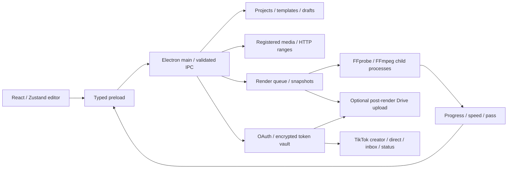

# Архитектура AutoClippingUpgrader

## Процессы и контракты

Приложение разделено на Electron main, sandboxed preload и React renderer. Renderer не имеет Node.js или произвольного IPC. Типизированные методы и проверка отправителя ограничивают работу с файлами, шаблонами, рендером и публикациями. Секреты OAuth не входят в Zustand или JSON проекта.

`shared/template.ts` — единая Zod-схема и TypeScript-контракт. Его используют JSON-редактор, библиотека, preview и FFmpeg. `shared/geometry.ts` описывает координаты, crop, пересчёт разрешения, snapping и прозрачность. Оценка размера — чистая функция `shared/estimate.ts`.



## Реализованная структура

```text
src/
├── main/
│   ├── index.ts                     BrowserWindow, security, lifecycle
│   ├── editor/
│   │   ├── handlers.ts              editor IPC, dialogs, thumbnails, jobs
│   │   ├── media-registry.ts        opaque media URLs, ranges, MIME allowlist
│   │   ├── repository.ts            library, project import/export, atomic draft
│   │   ├── render-queue.ts          serial queue, immutable parameter snapshots
│   │   └── window-lifecycle.ts      final draft flush on close
│   ├── engine/
│   │   ├── graph.ts                 one filter_complex for final composition
│   │   ├── encoding.ts              NVENC/x264/x265 encoding options
│   │   ├── plan.ts                  validation, argv, file-level passes
│   │   ├── preview.ts               exact reference PNG from the same graph
│   │   ├── renderer.ts              GPU preflight, fallback, cancel, output
│   │   ├── probe.ts                 source metadata and rotation
│   │   ├── process.ts               spawn with shell:false
│   │   └── progress.ts              partial stdout/stderr line parser
│   └── services/
│       ├── auth/                    PKCE, state, refresh, OS-backed storage
│       ├── tiktok/                  OAuth, creator/direct/inbox/status, chunks
│       ├── google-drive/            OAuth, folders, resumable upload/checkpoints
│       ├── http.ts                  timeouts, structured errors, URL allowlists
│       ├── config.ts                main-only OAuth configuration
│       ├── publishing-hub.ts        validated publishing IPC and upload jobs
│       └── render-and-archive.ts    standalone backend render/archive hook
├── preload/index.ts                 narrow contextBridge, File -> native path
├── shared/
│   ├── template.ts                  schema, media/trim types
│   ├── defaults.ts                  starter template
│   ├── geometry.ts                  composition coordinates and resize
│   ├── estimate.ts                  live file size calculation
│   ├── editor.ts                    project/job DTOs and editor bridge
│   ├── publishing.ts                API/UI publishing DTOs
│   └── bridge.ts                    complete desktop bridge
└── renderer/
    ├── main.tsx                     mount and error boundary
    ├── styles.css                   Tailwind and dark editor layout
    ├── app/App.tsx                  three-column shell, JSON, project, shortcuts
    ├── stores/editor-store.ts       Zustand, history, selections, trim, settings
    ├── components/ui/               Radix/CVA button and form primitives
    ├── lib/                         class merging, timecode, preview chromakey
    └── features/
        ├── templates/TemplatePanel.tsx
        ├── layers/LayerPanel.tsx
        ├── canvas/PreviewCanvas.tsx
        ├── timeline/MultiTrackTimeline.tsx
        ├── render/RenderInspector.tsx
        └── publishing/ConnectionsPanel.tsx
```

## Media и preview

`acu-media://asset/UUID` раскрывает только зарегистрированные файлы поддерживаемых типов. Main обрабатывает GET/HEAD и одиночный Range; URL не преобразуется в произвольный путь. Drag-and-drop извлекает native path через `webUtils` в preload. Отдельный реестр источников проверяется перед рендером; публикация принимает UUID ранее выбранного или созданного приложением файла.

Canvas 2D использует координаты фактического холста и коэффициент отображения. FontFace загружает выбранные локальные шрифты через тот же ограниченный протокол. Быстрый preview отличается от FFmpeg по некоторым деталям фильтров и анимаций; reference PNG вычисляется самим FFmpeg без браузерной подмены. Данные прямоугольников и timing остаются общими.

## Состояние и диск

Zustand хранит template, trim, source reference, выделение, zoom/grid/snap, настройки, undo/redo и отображаемые задания. История содержит до 50 снимков template/trim; GPU-процессы и OAuth-токены туда не попадают. Перетаскивание группируется в одну правку.

Проекты имеют формат AutoClippingUpgrader version 1 и содержат JSON-шаблон, путь исходника, trim и editor settings. Локальный draft записывается атомарно с debounce; окно перед закрытием даёт renderer ограниченное время на финальную запись. Библиотека хранится в userData/editor/templates с именами, полученными из SHA-256 ID; произвольный template_id не превращается в путь записи.

JSON ссылается на assets и шрифты на диске; перенос файлов не скрывается за фиктивным архивированием. Отсутствующий исходник или asset приводит к предупреждению и возможности заменить файл.

## Рендер и публикации

Очередь исполняется в main по одному заданию, хранит снимок параметров при enqueue и поддерживает AbortSignal для текущего задания. Все filter-файлы, captions, fonts и passlogs находятся в отдельной временной папке. Выходной MP4 сначала сохраняется во временное место и копируется с запретом перезаписи. Обработка FFmpeg не блокирует React.

После успеха результат регистрируется как local media и как файл панели публикации. При явно включённой опции Drive запускается после рендера; ошибка облака не удаляет локальный результат. TikTok не публикуется от самого факта рендера: у него есть отдельные выбранные пользователем режим, настройки и действие.

OAuth использует OS safeStorage и хранение без plaintext fallback. TikTok перехватывает заданный HTTPS callback в дочернем окне или принимает callback активной внешней сессии вручную. Google использует системный браузер и loopback receiver. Настройки реальных клиентов и ограничения зарегистрированных приложений описаны в publishing.md.

## Проверки и границы

Node-тесты проверяют схему, geometry, Zustand history, media ranges, library/draft, queue, code generation и API-протоколы. FFmpeg-интеграции создают реальные ролики с четырьмя кодеками и пятью режимами управления качеством/битрейтом. Native Electron-тесты проверяют safeStorage, preload/IPC и сквозной editor workflow с реальным экспортом и сохранением хеша исходника.

Сквозной тест не выполняет облачную отправку; OAuth/API-ответы в сервисных тестах контролируемые. Реальный облачный вход требует реквизитов приложений. Очередь не восстанавливается после выхода; автоматическая транскрибация речи и YouTube Publishing API не реализованы. Windows installer и portable EXE добавлены отдельной упаковкой electron-builder со встроенными FFmpeg/FFprobe вне ASAR; описание — в windows-build.md.

Практические инструкции: [editor.md](editor.md), [publishing.md](publishing.md).


## Эффекты 0.4

`shared/layer-effects.ts` нормализует новые и legacy-поля, вычисляет layout и motion. `engine/ass.ts` генерирует безопасные ASS-события и скруглённые векторные плашки, `graph.ts` выбирает ASS/drawtext и строит chromakey/despill с умножением альфа-масок. RichTextPanel/BackgroundPanel находятся в правом инспекторе. Изолированный AI worker использует локальные quantized ISNET/WASM assets через `acu-media://ai`; main проверяет и сохраняет PNG. Подробнее: [layer-effects.md](layer-effects.md).

## Многодорожечная модель (2026-11-02)

Необязательный `template.timeline` хранит видео- и аудиодорожки, source trim и положение каждого сегмента, gain, fades, Mute/Solo/Hide/Lock. `shared/timeline.ts` содержит Zod-схему, длительность, активность/громкость аудио, split/trim и snapping; `timeline-migration.ts` переводит исходник и legacy overlays в дорожки. `stores/timeline-store.ts` предоставляет Zustand API поверх единой истории template/trim в editor-store. Шаблонные слои связаны через overlay_id, отдельные видео используют transform, основной клип — main_clip_layout.

`MultiTrackTimeline.tsx` заменяет filmstrip; `Waveform.tsx` строит реальные пики через Web Audio. `lib/timeline-preview.ts` управляет независимыми decoder/GainNode и композитингом сегментов на общем clock. `engine/graph.ts` размещает обрезанные видеосегменты по PTS, накладывает дорожки снизу вверх и сводит звук через afade/adelay/amix. `plan.ts` использует общую длительность для -t, прогресса и оценки размера; первый проход two-pass и reference PNG исключают аудиофильтры. Проекты и черновики сохраняют timeline без смены версии файла. Подробности и ограничения: [multitrack-timeline.md](multitrack-timeline.md).

## BCC-style keying (0.6)

shared/bcc-chroma.ts задаёт Zod-схему и общую математику. renderer/lib/BccChromaKeyShader.ts выполняет многопроходный GLSL; BccLayerRenderer захватывает нижний композит в координатах слоя. Его используют обычный PreviewCanvas и TimelinePreview. BccBackgroundPanel содержит четыре секции и диагностические view modes. engine/bcc-chroma.ts компилирует primary mask, morphology, levels/gamma, despill, alpha merge и canvas-space light wrap; graph.ts подключает его к каждому BCC-слою/сегменту. Ни IPC-контракт, ни права renderer не расширены. Подробности и допуски: [bcc-chroma-key.md](bcc-chroma-key.md).

## Проекты .acup (0.7)

`shared/project.ts` задаёт расширение и безопасное имя файла; `shared/editor.ts` содержит совместимую схему проекта версии 1 и отдельную схему локального черновика с путём текущего файла. `editor/project-files.ts` перечисляет все ссылки, разрешает относительные пути и экспортирует медиа через staging-каталог: сначала копии, затем атомарная публикация манифеста. `atomic-json.ts` используется и библиотекой, и проектами.

Main хранит активный путь независимо от renderer, разрешает повторное сохранение только выбранного/открытого проекта и проверяет sender каждого IPC. `features/projects/project-actions.ts` управляет Save/Save As, dirty revision/settings, отменой и заменой композиции; `ProjectMenu.tsx` даёт меню «Файл». Экспорт не меняет активный проект, импорт создаёт несохранённую копию. Автосохранение приостанавливается во время смены проекта и возобновляется для итогового состояния. Подробнее: [projects.md](projects.md).
